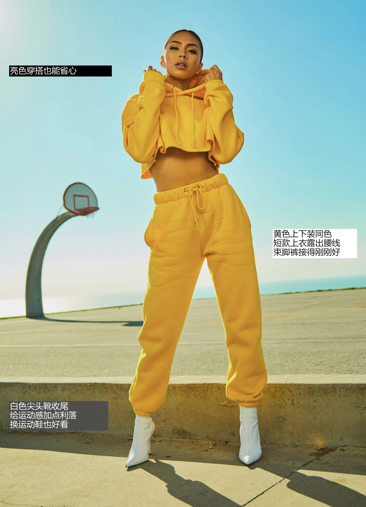

# smart-xhs-outfit-overlay

为小红书穿搭照片自动生成文案，再用 Python / Pillow 将文字排版到原图上的 Codex Skill

支持 OOTD、秋冬、韩系、通勤等帖子类型，保留照片中的人物与服装，不依赖 AI 重绘



## 默认效果

- 一行一句，末尾不加句号
- 标题、说明和补充文字统一字号与行距
- 在安全留白内均衡分布，左右交替，避开人物脸部与主要穿搭细节
- 黑底白字标题、白底黑字说明、灰底白字补充，也支持低饱和的图片主色衍生底框
- 输出 PNG / JPG、可复制文案，以及可编辑的布局配置
- 支持批处理；某一张失败时保留其他图片的结果并记录错误

## 在 Codex 中使用

将仓库克隆到本机任意目录，在 Codex 上传穿搭照片并发送：

```text
请读取 <仓库绝对路径>/SKILL.md
使用这个 Skill 处理我上传的照片
帖子类型：韩系秋冬穿搭
语气：日常自然
侧重：配色和单品解析
输出 PNG、JPG 和生成文案
```

也可以把本目录放入当前 Codex 环境实际使用的 skills 目录，再通过 `$smart-xhs-outfit-overlay` 调用

识图和文案由具备视觉能力的 Codex 宿主完成，脚本负责确定性的图片渲染。无需额外 API Key；单独运行脚本需要已有的识图和文案 JSON 配置

## 本地运行示例

需要 Python 3.10+、Pillow，以及可显示中文的字体。已在 Windows / Python 3.11 / Pillow 13 上验证；其他系统的字体路径请按实际环境指定

```bash
git clone https://github.com/yuehao2323/smart-xhs-outfit-overlay.git
cd smart-xhs-outfit-overlay
python -m pip install -r requirements.txt
python scripts/overlay.py render examples/ootd.json --out output/demo --format both
```

Windows PowerShell 也可以运行以下命令，首次执行会在仓库下创建独立的 `.venv`：

```powershell
.\run.ps1 render examples\ootd.json --out output\demo --format both
```

脚本自动查找 Windows 微软雅黑、macOS PingFang 或 Linux Noto CJK。若没有找到中文字体，通过 `--font <字体文件路径>` 或环境变量 `XHS_FONT` 指定

每张图输出 `final.png` / `final.jpg`、`copy.txt`、`editable.json`、`layout.json` 和原始图片副本。修改 `editable.json` 后可以重新渲染；`layout.json` 用于查看最终像素坐标和测量结果

## 识图与批处理

```bash
python scripts/overlay.py inspect photo1.jpg photo2.jpg --out work/inspection
```

宿主读取 EXIF 转正后的预览并逐张识图，根据 inspection.json 中的尺寸和 SHA256 生成配置。字段说明见 [references/config.md](references/config.md)，运行流程见 [SKILL.md](SKILL.md)

批处理清单是配置路径组成的 JSON 数组：

```bash
python scripts/overlay.py batch examples/batch.json --out output/batch --format both
```

仓库批处理示例重复使用一张演示照片以展示任务隔离。处理不同照片时，必须逐张生成不同的识图坐标与文案配置

## 可调整的排版选项

| 配置 | 默认值 | 作用 |
| --- | --- | --- |
| `sentence_lines` | `true` | 完整短句单行显示，去掉句尾句号，过长时要求精简 |
| `uniform_font` | `true` | 所有框共用字号，需要缩小时同步缩小 |
| `distribution` | `balanced` | 按纵向中心等距、左右交替寻找安全位置 |
| `preset` | `compact-notes` | 直角框、小内边距、紧凑行距 |
| `fallback` | `panel` | 原图没有安全留白时扩展侧边说明区 |

旧版风格可以选择 `sentence_lines: false`、`uniform_font: false`、`distribution: grouped` 或 `preset: cards`

## 验证与限制

```bash
python scripts/test_overlay.py
```

15 项自动测试覆盖人物区域避让、框外像素保持、字号统一、均衡分布、单句单行、中文换行、文本溢出、EXIF 方向、原图指纹、侧栏及批量失败隔离

人物保护区由宿主视觉模型估计，程序检查与给定区域不相交，仍需查看成品确认。默认不裁剪原图、不放大小图；原图最长边超过 4096 时缩小。侧栏模式会改变画布比例。完整流程目前只用一张真实穿搭照片测试，未进行大规模照片评估

## 示例素材

测试照片来自 [Dom Hill / Unsplash](https://unsplash.com/photos/nimElTcTNyY)，仅用于展示穿搭叠字效果，不是用户本人照片，也不表示原作者为本项目背书。原始素材来源同时记录在示例配置的 `source_credit` 中
